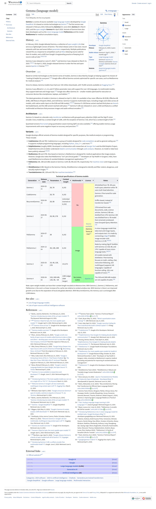

# Gemma.c

<div align="center">
  
</div>

<br>

Gemma 1, 2, 3 + multimodal implemented in a single file of pure C.

This is a from-scratch inference engine for Google's Gemma family of language
models: Gemma 1, 2 and 3, text-only and multimodal (SigLIP vision tower
included), W8A8 quantization, in one .c file with no dependencies beyond libc
and (optionally) OpenMP. The image decoding uses a minified build of stb_image
and stb_image_resize2 (PNG and JPEG only), embedded at the end of `gemma.c`.
See [Image decoding](#image-decoding).

The project started as a learning attempt to understand how LLMs work
end-to-end, inspired by [llama2.c](https://github.com/karpathy/llama2.c).

## Quick start
 
### 1. Export a model
 
Gemma weights are gated: accept the license on the model's Hugging Face page
and log in first (`huggingface-cli login`, or `hf auth login` on newer versions).

```bash
pip install -r requirements.txt
 
python export.py google/gemma-3-1b-it -o gemma-3-1b-it.bin
```

Export an INT8-quantized version, about a quarter of the fp32 size (half of
fp16, one byte per weight) and roughly 3.5x faster generation, or 1.8x if you
started from an fp16 file (see the benchmark below):
 
```bash
python export.py google/gemma-3-1b-it -o gemma-3-1b-it_q.bin -q
```

`export.py` arguments:

| Argument           | Description                                                               |
| ------------------ | ------------------------------------------------------------------------- |
| `modelfile`        | HuggingFace model id or a local directory                                 |
| `-o, --output`     | Output `.bin` path (required)                                             |
| `-d, --dtype`      | Weight precision: `float16` / `float32` / `bfloat16` (default: `float32`) |
| `-q, --quantize`   | Enable INT8 (W8A8) quantization                                           |
| `-c, --cache-path` | Custom HuggingFace cache directory                                        |

### 2. Build

```bash
make
```

`make` auto-detects whether you're on gcc/clang/msvc and picks safe flags for
each. If you get to choose the compiler, choose GCC since the GEMM loops vectorize
a lot better there, and prefill / SigLIP end up several times slower with
clang or MSVC at the same `-O` level. You can override the compiler or the
dtype from the command line (MSVC only supports float32):

```bash
make CC=clang
make DTYPE=FP16      # must match whatever -d you exported with, FP32 / FP16 / BF16
make debug           # -O0 -g -fsanitize=address,undefined, single threaded
```

The default is `make` with no `DTYPE`, i.e. float32, which matches an export
made without `-d`. So if you exported with `-d float16`, you must build with
`make DTYPE=FP16`, otherwise the loader will refuse the file with
`unsupported dtype 'f16' in model file`.

On Windows, WSL is the recommended option (see [Windows](#windows) for why). If
you really can't use WSL, then install MinGW-w64 or use MSYS2 and run make the
same way. The Makefile will automatically detect Windows_NT (and also links a
static binary so it doesn't need MinGW's DLLs sitting next to it :D).

If you'd rather invoke the compiler directly:

```bash
gcc -Ofast -march=native -mtune=native -fopenmp gemma.c -lm -o gemma  # gcc
clang -O3 -ffast-math -march=native -mtune=native -fopenmp gemma.c -lm -o gemma  # clang
```

Or if you are using MSVC (see [Windows](#windows)):

```powershell
cl /O2 /openmp:experimental /fp:fast gemma.c /link shell32.lib /Fe:gemma.exe
```

override with -DDTYPE at compile time (FP32 / FP16 / BF16):

```bash
gcc -Ofast -march=native -fopenmp -DDTYPE=BF16 gemma.c -lm -o gemma
```

### 3. Run inference
 
One-shot generation, with temperature set to 1.2, top-k 50, top-p 0.8,
repetition penalty 1.15:
 
```bash
./gemma gemma-3-1b-it_q.bin --prompt "Once upon a time" --temperature 1.2 --topk 50 --topp 0.8 --rpen 1.15
```

Sampled text:

> Once upon a time, in a small village nestled beside a sparkling forest, lived
  a young girl named Elara. She was known for her kindness and a peculiar
  talent: she could understand the whispers of the trees.
>
> The trees spoke to her, sharing stories of the past, offering guidance on the
  present, and sometimes even whispering warnings about what might be.  Elara
  spent her days wandering through the forest, listening intently, her small
  hands tracing the patterns of bark and leaves.
>
> One day, a travelling merchant arrived in the village. He carried with him a
  beautiful, intricately carved wooden box. The merchant, a gruff but kind man
  named Silas, noticed Elara’s unusual connection to the forest. He asked her
  if she knew anything about the box.
>
> Intrigued, Elara explained her ability to listen to the trees. Silas,
  skeptical at first, listened patiently as she described the way the forest
  felt, how it responded to her touch.  He realized that perhaps the box wasn't
  just a pretty object, but something far more significant.
>
> Silas revealed the box contained a single, smooth, grey stone. As soon as
  Elara touched it, a wave of warmth flowed through her, and she understood its
  purpose – to heal a withered grove of ancient trees, trapped in a perpetual
  winter.
>
> Together, Elara and Silas ventured into the deepest part of the forest. They
  faced treacherous terrain and dangerous creatures, but their combined
  knowledge of the forest and Elara’s unique connection to the trees allowed
  them to overcome every obstacle.
>
> Finally, they reached the heart of the withered grove. There, beneath a layer
  of ice, lay the stone, pulsing with a faint, sad light. With gentle hands,
  Elara placed the stone within the grove, and as it settled, the snow melted,
  and the trees began to breathe again, their branches reaching towards the sun.
>
> Elara and Silas returned to the village, hailed as heroes. The villagers
  celebrated their bravery and the magic of the forest, knowing that the
  whispers of the trees held a powerful truth. And Elara, the girl who
  understood the language of the woods, continued to wander, always
  listening, always learning, forever connected to the forest's heart.
>
> The End.**

An extra `**` at the end lol. This model was instruction fine-tuned and it
probably got a little confused about the raw text-completion format.

Interactive chat:
 
```bash
./gemma gemma-3-1b-it_q.bin --chat
```

> ---
> 
> `> Hiya!`
> 
> ---
>
> Hi there! How's your day going so far? 😊
>
> Is there anything you'd like to chat about or anything I can help you with?
>
> ---
> 
> `> Why do the stars blink?`
> 
> ---
> 
> That’s a fantastic question! It's a really interesting phenomenon!
>
> The “blink” you see in the stars is a result of a clever trick of how light
  travels through the Earth's atmosphere. Here's the breakdown:
>
> * **The Light Source:** Stars are incredibly far away, so we see them as
  tiny points of light.
> * **Atmospheric Turbulence:** The Earth’s atmosphere is constantly moving,
  swirling with air currents. These currents refract (bend) the starlight.
> * **The Blink Effect:** As the starlight passes through these turbulent air
  pockets, it’s constantly shifted and distorted. This causes a slight
  “blurring” of the image.  The stars appear to “blink” – they briefly appear
  to move – because their light trails are constantly being altered. It’s not
  that the stars are actually moving, but that the light is being changed and
  rearranged by the atmosphere.
>
> **Think of it like this:** Imagine looking at a winding road. If you move
  your head, the image on the road changes. It's the same principle with light!
>
> It's a testament to the incredible complexity of our atmosphere and how it
  interacts with light.
>
> Do you want to learn more about the science behind it, or would you like to
  know anything else about the stars?
>
> ---
> 
> `> Write a peom about stars`
> 
> ---
> 
> Okay, here’s a poem about stars:
> 
> **Celestial Echoes**
> 
> Across the velvet, dark and deep,
> A million diamonds softly sleep.
> Stars ignite, a silver dust,
> In cosmic realms, a sacred trust.
> 
> Each glimmer holds a distant fire,
> A sun’s embrace, a burning desire.
> Across the void, their light does leap,
> Secrets whispered, silent, deep.
> 
> Of ancient worlds and nebulae’s grace,
> Lost in time, a timeless space.
> Constellations dance, a mythic show,
> Where wonders bloom and starlight flow.
> 
> So gaze above, and let your soul,
> Be drawn to stories, making whole.
> For stars remain, a constant plea,
> A beacon bright for you and me.

Multimodal models take images inline in the prompt with `@image{...}`:
 
```bash
python export.py google/gemma-3-4b-it -o gemma-3-4b-it_q.bin -q
./gemma gemma-3-4b-it_q.bin --chat
```

> ---
> 
> 
> 
> `> Describe what you see in @image{assets/gemma.jpg}`
> 
> ---
> 
> Okay, here's a description of what I see in the image:
> 
> **Central Focus:**
> 
> *   **Cute Diamond:** The main subject is a large, vibrant red diamond that
  has been given a remarkably cheerful and endearing design. It has large,
  round, black eyes that give it a cartoon-like expression and a small, happy
  smile. The diamond is sitting on tiny, red, stubby legs, adding to the
  playful, almost childlike appearance.
> *   **Reflections:** The diamond has numerous reflective facets that catch
  the light, creating a sparkling effect. Those reflections appear almost like
  tiny rainbows, scattering light around.
> 
> **Background & Setting:**
> 
> *   **Letter 'C':** Behind the diamond is a large, white letter "C." It's
  slightly blurred, and has a subtle glow, suggesting it’s been lit from behind.
> *   **Color Palette:** The overall color scheme is dominated by red, white,
  and a light, pinkish-purple/gray gradient that forms the background. The
  lighting is a soft daylight, giving it a somewhat dreamy, polished look.
> *   **Surface:** The diamond is sitting on a reflective, light-colored
  surface (most likely metal or polished concrete) that casts a reflective
  pattern beneath it, furthering the overall shiny aesthetic.
> 
> **Overall Impression:**
> 
> The image has a whimsical and playful feel, thanks to the cartoonistic design
  of the diamond. The lighting and color choices create a vibrant and appealing
  atmosphere. It feels like a promotional image or illustration, likely aimed
  at attracting attention and conveying a sense of fun or value (perhaps
  associated with the letter "C" – like in a brand name).
> 
> Do you want me to describe any specific aspect of the image in more detail,
  or perhaps analyze the possible reasons for the artistic choices?

For very wide or tall images, `@longimage{...}` runs Gemma 3's pan & scan
utility first, feeding the model both the full downsized image and a few
higher-resolution crops:

> ---
>
> 
> 
> `> Help me read the text at the top of this wiki page @longimage{assets/gemma_wiki.jpg}`
>
> ---
>
> Okay, here’s the text from the top of the Wikipedia page on "Gemma (language
  model)":
> 
> ---
> 
> Gemma is a series of source-available large language models developed by
  Google DeepMind. It is based on similar technologies as Gemini. The first
  version was released in February 2024, followed by Gemma 2 in June 2024,
  Gemma 3 in March 2025, and the open weights Gemma 4 in April 2026. Variants
  of Gemma have also been developed, such as the vision-language model
  PaLI-Gemma and the model MedGemma for medical consultation topics.
> 
> **History** [edit]
> 
> In February 2024, Google debuted Gemma, a collection of open weight LLMs
  that serve as a lightweight version of Gemma. The initial release came in two
  sizes: neural networks with two and seven billion parameters respectively.
  Multiple publications viewed this as a response to competitors such as Meta’s
  releasing source code for their AI models, and a shift from Google’s
  longstanding practice of keeping its AI models source code private.
  [1][2][3][4]
> 
> Gemma 2 was released on June 27, 2024, [5] and Gemma 3 was released on March
  12, 2025.[6] On April 3, 2026, Google released Gemma 4 under the free and
  open-source Apache 2.0 license.[7]
> 
> **Overview** [edit]
> 
> Based on similar technologies of the Gemini series of models, Gemma is
  described by Google as helping support its mission of "making AI technology
  more widely accessible." The Gemma family has been reported to have an
  average size of 7 billion parameters, allowing it to run on consumer
  hardware. [8]
> 
> Since its release, Gemma has had over 150 million downloads, with 70,000
  variants available on Hugging Face. [8]
> 
> The Gemma generation of models currently only supports English, although they
  are working on multilingual long context open LLM’s. [8]
> 
> ---
> 
> Do you want me to read another section of the text or provide a summary of
  the entire page?

## Windows

If you want a better performance in Windows, I would recommand to use WSL.
The native Windows builds work, but they leave a lot of throughput on the
table currently, for mainly two reasons:

**libgomp**

So a decode step contains a few hundred `parallel for` regions per token.
glibc's libgomp on Linux gets through those fork/join pairs in a couple of
microseconds each, but my tests showed that the MinGW build of libgomp
(MSYS2) is roughly 30x more expensive per region! Since decode is quite a long
chain of those regions, the overhead ends up being the whole story. WSL build
decodes about 1.7x faster than MinGW build in my tests.

Fixing that from the C side would mean hand-rolling the spin/wait instead of
using libgomp, which is not included in my current plan.

**The compiler's auto-vectorizer**

The other half is the GEMM, and there the ranking flips depending on what you
measure:

| compiler | prefill / SigLIP (GEMM-heavy) | decode (GEMV-heavy) |
| --- | --- | --- |
| gcc     | fastest         | slowest (libgomp) |
| clang   | in between      | in between        |
| MSVC    | slowest         | fastest           |

The GEMM kernels are plain C with no intrinsics yet, so the prefill number is
basically "how well does this compiler vectorize that loop", and GCC is
noticeably better at it than clang or MSVC. The decode ranking is the libgomp
problem above, MSVC's `/openmp` runtime doesn't seem to charge the same
per-region tax (but still slower than WSL).

So there is currently no Windows build that wins both halves: gcc gives you the
best prefill and the worst decode, MSVC the exact opposite, clang sits in the
middle. WSL + gcc is the only combination that's good at both, which is also
what every number in the [benchmark](#benchmark) was measured with. One more
reason not to reach for MSVC is that it has no `_Float16` / `__bf16`, so fp16
and bf16 weights are a gcc/clang affair on Windows anyway.

## Usage
 
```text
./gemma <modelfile> [options]
```
 
### Arguments
 
| Argument | Description |
| --- | --- |
| `modelfile` | Path to the model file |
 
### Options
 
| Option              | Description                                       | Default               |
| ------------------- | ------------------------------------------------- | --------------------- |
| `--seqlen <N>`      | Set sequence length                               | 4096                  |
| `--tokens <N>`      | Set max number of new tokens to generate          | -1                    |
| `--topk <N>`        | Set top-k sampling value                          | 0                     |
| `--seed <N>`        | Set random seed                                   | current time          |
| `--chunk <N>`       | Set prefilling chunk size, must be >= 1           | 1024                  |
| `--temperature <F>` | Set temperature value, must be >= 0.0             | 1.0                   |
| `--topp <F>`        | Set top-p sampling value, must be 0.0 < p <= 1.0  | 1.0                   |
| `--rpen <F>`        | Set repetition penalty, must be >= 1.0            | 1.0                   |
| `--prompt <S>`      | Set input prompt, ignored if chat mode is enabled | "Once upon a time"    |
| `--threads <N>`     | Set OpenMP thread count, must be >= 1             | 8                     |
| `--chat`            | Enable chat mode                                  | -                     |
| `--text-only`       | Disable multimodal capability                     | -                     |
| `--no-mmap`         | Disable mmap (memory mapped file)                 | -                     |
| `--verbose`         | Print model info and the perf report              | -                     |
| `--help`, `-?`      | Display this help message                         | -                     |

`--threads` defaults to 8, which is a safe middle ground on most machines; set
it to your physical core count if you're chasing numbers.

### Controls
 
| Control  | Description                              |
| -------- | ---------------------------------------- |
| `Ctrl+C` | Gracefully interrupt generation and exit |

### The `--verbose` report

`--verbose` prints the model configuration and the inference arguments up
front, and a performance report when generation finishes:

- wall time per phase: prompt ingestion (prefill), token generation
  (decode), and image ingestion (vision, multimodal models only)
- for each instrumented function (`rmsnorm`, `layernorm`, `quantize_act`,
  `gemv_fpx`, `gemv_int8`, `gemm_fpx`, `softmax`, `gelu`, `rope`,
  `sample_from_logits`, ...): the call count, total time, average per call,
  and its share of the phase

One caveat on the "share" column: it's relative to the sum of the instrumented
functions, not to the wall clock. Kernels that run inside an OpenMP region are
timed once per thread, so their totals add up to more than the wall time by
roughly the thread count, which is exactly the number you want when you're
looking for where the CPU time goes.

### Examples
 
| Command                                                                                         |
| ----------------------------------------------------------------------------------------------- |
| `./gemma model.bin --seqlen 2048 --temperature 0.8 --chat`                                      |
| `./gemma model.bin --prompt "Hello I'm a language model," --tokens 100 --topk 50 --seed 12345`  |


## Image decoding

Image input uses [stb_image](https://github.com/nothings/stb) v2.30 and
stb_image_resize2 v2.18 by Sean Barrett (public domain / MIT), embedded in
`gemma.c` as a minified build limited to PNG and JPEG (`STBI_ONLY_PNG`,
`STBI_ONLY_JPEG`). This embedded copy was produced with ad-hoc minification
scripts plus some manual edits, so it's probably not byte-reproducible from
upstream.

Supported: PNG, baseline/progressive JPEG.

Not supported: TGA, BMP, PSD, GIF, HDR, etc.

stb_image is not designed as a hardened parser, so only load images you trust.

## Models and memory

Sizes are what `export.py` actually writes out. The same checkpoint comes in
three very different sizes (int8 is a quarter of fp32, fp16/bf16 is half)
which is the main thing to know before picking a dtype:

| Model | Params | fp32 | fp16 / bf16 | int8 (`-q`) | Status |
|---|---:|---:|---:|---:|---|
| gemma-3-270m | 268M | 1.1 GB | 0.54 GB | 0.28 GB | benchmarked |
| gemma-3-1b | 1.0B | 4.0 GB | 2.0 GB | 1.0 GB | benchmarked |
| gemma-2-2b | 2.6B | 10.5 GB | 5.2 GB | 2.6 GB | benchmarked |
| gemma-3-4b-it | 4.3B | 17.2 GB | 8.6 GB | 4.3 GB | benchmarked |
| gemma-1-7b-it | 8.5B | ~34 GB | 17 GB | - | fp16 works, `-q` doesn't |
| gemma-3-12b-it | 12.2B | ~48 GB | ~24 GB | 12 GB | int8 benchmarked |

At runtime you need the weights plus the KV cache (printed by `--verbose`) plus
the prefill attention buffer, which is roughly `chunk × n_heads × seqlen`
floats, so a 12B model at `--seqlen 4096 --chunk 4096` wants about a gigabyte
on top of the file size. Everything else `export.py` can read (gemma-2-9b/27b,
gemma-3-27b, ...) should work the same way, it just hasn't been benchmarked
here.

## Benchmark

<!-- BENCH:BEGIN -->
WSL2 / Ubuntu, Intel Core Ultra 5 225H (14 threads), 30 GB RAM, gcc 15.2,
`-O3 -ffast-math -march=native -mtune=native -fopenmp`.

Every cell: `--seqlen 2048 --threads 10 --temperature 0 --tokens 100
--no-mmap --text-only --chunk 2048` (chunk 2048 was the fastest of
64/128/256/512/1024/2048 on a 1002-token prompt).

* **prefill tok/s** - 1002-token prompt, prompt ingestion only
* **decode tok/s** - 100 tokens after a 5-token prompt ("short ctx") or after
  the 1002-token prompt ("1k ctx")

Two warm-up runs are thrown away, then 5 runs are measured, and the rest is a
median. `n` is the number of samples behind a row and `±%` is the spread I
actually saw. The 270m and 1b rows pool their `-pt` and `-it` checkpoints (same
configuration, different weights), which is why those two have twice the
samples of everything else.


| model | params | dtype | quant | prefill tok/s | decode tok/s (short ctx) | decode tok/s (1k ctx) | ms/token (1k ctx) | n | ±% |
|---|---|---|---|---:|---:|---:|---:|---:|---:|
| gemma-3-270m | 268M | fp32 | no | 619.2 | 65.5 | 56.4 | 17.7 | 8 | 1.7 |
| gemma-3-270m | 268M | fp32 | yes | 1332.9 | 213.7 | 141.0 | 7.1 | 13 | 8.3 |
| gemma-3-270m | 268M | fp16 | no | 450.7 | 108.3 | 77.1 | 13.0 | 8 | 2.3 |
| gemma-3-270m | 268M | fp16 | yes | 1081.0 | 192.0 | 112.4 | 8.9 | 13 | 2.1 |
| gemma-3-270m | 268M | bf16 | no | 365.0 | 17.3 | 12.1 | 82.4 | 13 | 4.3 |
| gemma-3-270m | 268M | bf16 | yes | 737.9 | 99.9 | 29.0 | 34.5 | 8 | 2.8 |
| gemma-3-1b | 1.0B | fp32 | no | 129.2 | 18.1 | 17.0 | 58.7 | 8 | 2.2 |
| gemma-3-1b | 1.0B | fp32 | yes | 356.0 | 65.3 | 53.4 | 18.7 | 13 | 3.0 |
| gemma-3-1b | 1.0B | fp16 | no | 103.4 | 31.6 | 26.6 | 37.7 | 8 | 2.1 |
| gemma-3-1b | 1.0B | fp16 | yes | 326.0 | 60.5 | 45.1 | 22.2 | 8 | 2.5 |
| gemma-3-1b | 1.0B | bf16 | no | 91.3 | 4.7 | 4.0 | 248.4 | 8 | 0.6 |
| gemma-3-1b | 1.0B | bf16 | yes | 246.8 | 36.5 | 15.3 | 65.5 | 8 | 2.8 |
| gemma-2-2b | 2.6B | fp32 | no | 47.4 | 7.2 | 6.3 | 159.5 | 9 | 6.3 |
| gemma-2-2b | 2.6B | fp32 | yes | 141.7 | 25.5 | 17.3 | 57.7 | 4 | 2.0 |
| gemma-2-2b | 2.6B | fp16 | no | 39.2 | 11.7 | 9.6 | 103.6 | 4 | 1.8 |
| gemma-2-2b | 2.6B | fp16 | yes | 139.8 | 24.4 | 15.4 | 65.1 | 4 | 1.6 |
| gemma-2-2b | 2.6B | bf16 | no | 34.8 | 1.9 | 1.5 | 666.7 | 4 | 0.2 |
| gemma-2-2b | 2.6B | bf16 | yes | 114.2 | 15.5 | 4.7 | 211.4 | 4 | 1.3 |
| gemma-3-4b | 4.3B | fp32 | no | 30.1 | 4.6 | 3.9 | 254.5 | 4 | 3.1 |
| gemma-3-4b | 4.3B | fp32 | yes | 84.2 | 16.7 | 11.4 | 87.6 | 9 | 3.4 |
| gemma-3-4b | 4.3B | fp16 | no | 22.0 | 7.5 | 6.2 | 161.8 | 9 | 3.9 |
| gemma-3-4b | 4.3B | fp16 | yes | 89.0 | 15.0 | 11.4 | 87.6 | 9 | 3.6 |
| gemma-3-4b | 4.3B | bf16 | no | 21.1 | 1.2 | 1.0 | 1010.1 | 9 | 3.9 |
| gemma-3-4b | 4.3B | bf16 | yes | 70.1 | 10.9 | 3.6 | 278.6 | 9 | 8.6 |
| gemma-1-7b | 8.5B | fp16 | no | 10.7 | 3.7 | 3.1 | 318.0 | 4 | 4.0 |
| gemma-3-12b | 12.2B | fp32 | yes | 28.2 | 5.5 | 4.3 | 230.7 | 4 | 2.2 |
| gemma-3-12b | 12.2B | fp16 | yes | 27.4 | 5.4 | 4.0 | 250.6 | 9 | 4.9 |

| model | q/nq (fp32) | q/nq (fp16) | q/nq (bf16) | fp16/fp32 (nq) | fp16/fp32 (q) |
|---|---:|---:|---:|---:|---:|
| gemma-3-270m | 3.26× | 1.77× | 5.78× | 1.65× | 0.90× |
| gemma-3-1b | 3.61× | 1.92× | 7.71× | 1.75× | 0.93× |
| gemma-2-2b | 3.55× | 2.09× | 8.14× | 1.63× | 0.96× |
| gemma-3-4b | 3.60× | 2.00× | 9.41× | 1.62× | 0.90× |
| gemma-3-12b | - | - | - | - | 0.98× |

Ratios are decode throughput from the first table (higher = the first dtype
wins). Two things worth noting: int8 buys 3.3-3.6x over fp32 and 1.8-2.1x over
fp16, and for an already-quantized model FP16 is actually *slower* than FP32
(0.90-0.98x). The dequant math is fp32 anyway, so building with `DTYPE=FP16`
just adds conversions.

What I didn't measure: 7b int8 (the activation scalers are incompatible with
the gemma-1 pre-norm layout, the output is garbage), 7b fp32 (~32 GB), 7b bf16
(same size as fp16 but 6x slower), 12b fp32 (45 GB doesn't fit), 12b fp16/bf16
(23 GB, ~20 min per run), 12b bf16 int8.

One more caveat: bf16 runs in software on this CPU (no AVX512-BF16), so every
`bf16 <-> float` conversion becomes a big libgcc call, which is where the 6-40x
gap comes from. On a machine with AVX512-BF16 the bf16 column would look very
different.
<!-- BENCH:END -->

### Reproducing

Everything between the two `BENCH` markers above is generated by
[`bench/bench.py`](bench/bench.py). It walks `models/`, and for every model,
every dtype and both the plain and int8 export it exports a `.bin`, benchmarks
it, and renders the tables. `bench/results.json` is the state file: it's
rewritten after every config and anything already in it is skipped, so an
interrupted overnight run just continues where it stopped.

```bash
# exports need torch, the numbers want WSL: point --export-python at the venv
python3 bench/bench.py run --dry-run            # what would be measured
python3 bench/bench.py run --export-python /mnt/d/repo/venv/Scripts/python.exe

python3 bench/bench.py render --update-readme   # rewrite the block above
```

Worth knowing that this scipt is AI-generated :D See [`bench.py`](bench/bench.py)
for more details on how to use it.

## Project layout

```
.
├── gemma.c        # The inference engine (minified stb image decoder embedded at the end of the file)
├── Makefile       # Cross-platform build script
├── export.py      # HuggingFace -> .bin weight exporter
├── bench/bench.py # Benchmark harness: exports, measures, renders the table
├── model.py       # Reference PyTorch implementation
├── sample.py      # PyTorch-side sampling logic
├── preprocess.py  # PyTorch-side image pre-processor
└── tokenizer.py   # Reference tokenizer implementation
```

Please note that the Python files aren't needed to *run* the model, only
`gemma.c` and a `.bin` file are. They exist to produce that `.bin` file from a
real HuggingFace checkpoint, and serve as a side-by-side reference.


## Known limitations

- **One request at a time.** No batching, no continuous batching, no
  prompt/prefix cache, every run re-prefills from scratch.
- **`--seqlen` is fixed at load.** The KV cache is allocated up front and the
  prefill attention buffer is roughly `chunk × n_heads × seqlen` floats, so
  memory follows the flags, not what the conversation actually uses.
- **Only fp16 decoding has a hand-written SIMD path** (F16C + FMA on x86-64).
  fp32 and bf16 GEMV/GEMM are plain loops that lean on auto-vectorization, and
  there is no VNNI or NEON code yet.
- **bf16 is only worth using on AVX512-BF16 hardware.** Everywhere else GCC
  turns each `bf16 <-> float` conversion into a big libgcc call, and bf16 ends
  up 6-40x slower than fp16 (see the benchmark).
- **W8A8 quantization doesn't work for Gemma 1.** Its pre-norm layout doesn't
  match the activation scalers `export.py` emits, so a quantized Gemma 1
  checkpoint produces garbage. Use fp16 for those.
- Quantizing trades a little output quality for size and speed; the benchmark
  above only measures throughput.
- **No stop strings.** Generation ends at EOS/EOT, `--tokens`, or `--seqlen`.
- **Long prefills are silent.** A 12B model spends ~35 s on 1000 tokens with
  nothing printed; there's no progress indicator yet.
- **GCC is the fast path.** Prefill and SigLIP are several times slower with
  clang or MSVC at the same `-O` level, because the GEMM kernels are plain C
  and lean on the compiler to vectorize them. Hand-written intrinsics would
  level that out; see [Windows](#windows).
- **Native Windows builds lose to WSL.** MinGW's libgomp makes decode ~1.7x
  slower than Linux, and no single Windows compiler wins both prefill and
  decode, details in [Windows](#windows).
- CPU only. No GPU, no distributed anything.

## Roadmap
 
- [ ] Clean up the messy code of `export.py`
- [ ] KV cache quantization
- [ ] W4A8 quantization
- [x] Multimodal inference
- [ ] Support W8A8 for Gemma 1 models
- [ ] Gemma 4 architecture support
- [ ] Further optimize GEMM
- [ ] Pack the weights once at load instead of per GEMM call
- [ ] FP32 AVX2 / int8 VNNI / ARM NEON kernels
- [ ] Batching and prefix caching
- [ ] Speculative decoding
- [ ] HTTP server implementation
- [ ] Fancier CLI
- [ ] Runtime dtype dispatch
- [ ] A PyTorch training script

## Acknowledgements
 
- [Google Gemma](https://ai.google.dev/gemma) official models and technical reports
- [llama2.c](https://github.com/karpathy/llama2.c) for inspiring this project
- [stb](https://github.com/nothings/stb) by Sean Barrett, for the image decoder and resizer

## License

MIT, for the code in this repository, see [LICENSE](LICENSE). The embedded stb
code is public domain / MIT under its own terms. Model weights are not covered
by this license; they are subject to Google's
[Gemma Terms of Use](https://ai.google.dev/gemma/terms).
